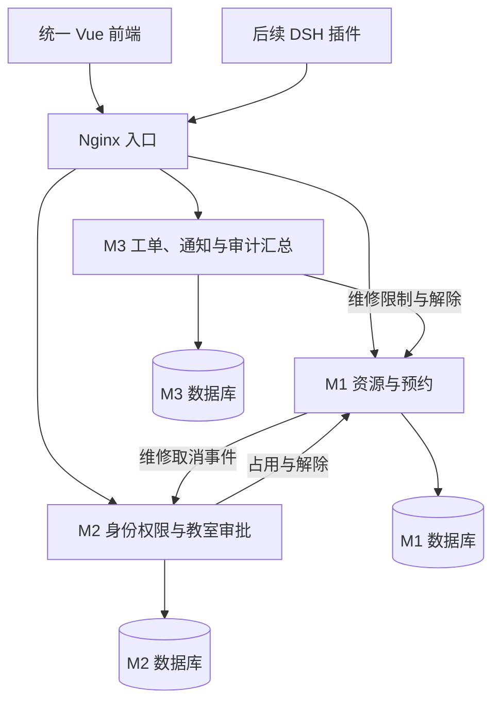

# 总体架构与公共层设计草案

更新日期：2026-10-20。本文整理前期讨论的目标架构，未创建代码。用户确认范围见 [DECISIONS](DECISIONS.md)；具体实现方案标记为待评审。

## 目标与运行结构

一个仓库、一个 Vue 前端、三个 Spring Boot 应用。三个业务模块组各自维护模块，公共层按能力归属到对应服务，不新增第四个 D 服务。



三个数据库位于同一 MySQL 实例，账号隔离。身份校验请求指向 M2；通知及汇总审计投递指向 M3，为简化图形未画出。它们通过持久化任务/统一客户端连接，不能使业务服务直接读取其他服务的表。

## 统一技术方案

| 部分 | 目标选择 | 状态/约束 |
| --- | --- | --- |
| 前端 | Vue 3、TypeScript、Vite | Vue/TS 方向已确认；组件和工具细节待评审 |
| 页面与状态 | Element Plus、Vue Router、Pinia、Axios | 统一布局、样式、请求与错误展示；不各组单独搭一套前端 |
| 前端工程 | Node.js 24、npm、ESLint、Prettier | 固定运行时和依赖锁，TS 严格检查，Composition API/script setup |
| 后端 | Java 21、Spring Boot 3.5 系列、Maven Wrapper | Java/Spring Boot 方向已确认；统一父工程管理依赖 |
| 数据与权限 | Spring Data JPA、Spring Security、MySQL 8.4、InnoDB、Flyway | 禁用自动修改表结构，复杂查询和锁操作可使用 SQL |
| 接口 | OpenAPI 3.0.3、JSON/HTTP | 接口契约先行；目前只有 Markdown 草案，还没有 OpenAPI 文件 |
| 测试 | JUnit、Spring Boot Test、Testcontainers、Vitest、Playwright | MySQL 验证持久化及并发，关键流程连接真实服务 |
| 交付 | Docker Compose、Nginx、课程要求的 CodeArts | GitHub 分享与 CodeArts 配合待核实 |
| 附加项 | TypeScript DSH 插件 | 不在业务后端再建一套 Agent 业务逻辑 |

这些是既有设计建议，不是本次重新核验的最新版本清单。F02 初始化时按官方兼容要求锁定精确版本，并记录依据，之后全组统一升级。首版不用 Redis、消息队列、注册中心或 Kubernetes；新增基础设施须说明具体需求与成本。

## 公共能力归属提案

| 能力 | 逻辑所有者 | 数据/接口边界 |
| --- | --- | --- |
| 用户、院系、登录会话、RBAC | M2 | 自建账号与可配置角色权限；提供身份校验及必要身份查询 |
| 教室、座位、开放时间、插座、院系归属 | M1 | 所有主数据修改归 M1；其他组只通过资源接口访问 |
| 可用性与按来源限制 | M1 | 唯一的资源占用写入方，整室审批和维修通过接口影响资源 |
| 通知中心 | M3 | 保存站内消息、已读、邮件投递与重试；业务服务决定事件及接收人 |
| 审计格式与汇总 | M3 牵头 | 各服务本地事务留原始审计，再汇总；不能依赖远端审计成功才保存业务 |
| 后台任务基础 | 公共组件，各业务所有者使用 | 提供持久化、重试及去重机制；到期业务动作由所属模块执行 |
| 公共前端 | 前端公共负责人，待认领 | 登录、布局、导航、请求、全局错误、公共表单和通知入口 |
| 迁移、环境和流水线 | 工程负责人，待认领 | 负责统一编排；每组提交自身脚本、配置、测试和健康检查 |

该划分需 F01 书面评审，尤其 M1 的业务量和公共资源职责较重。公共能力负责人、评审人、故障联系人须实际认领；“归属某模块”不等于工作必须由某一个人独立完成。

## 业务数据与完整工作范围

| 模块 | 自己拥有的数据 | 后续完整功能 |
| --- | --- | --- |
| M1 | 教室、座位、开放规则、预约、签到、违约、资源限制、资源操作结果 | 条件查询、预约与取消、历史复用、每日教室签到码、提醒与逾期任务、运营统计 |
| M2 | 用户、院系、角色权限、会话、申请、审批步骤和历史 | 资格、多级审批、驳回、超时、撤销、资源同步 |
| M3 | 工单、派单、维修、验收、评价、通知、汇总审计 | 报修、派单、维修、超时升级、验收及评价 |

跨服务关联保存字符串 UUID。名称可以保留展示快照，但不能用快照绕过实时资格、权限或资源检查。完整表结构、索引、迁移编号尚未设计完成，不能据此假定已有数据库模型。

## 身份与服务鉴权提案

演示账号覆盖学生、院系审批人、资源管理员、派单员、维修人员与系统管理员。角色可新增并配置操作权限，数据范围分本人、本院系、全校；界面菜单隐藏不能替代后端权限检查。

P04 提案使用随机 Bearer 会话令牌，M2 保存摘要、支持注销和禁用，有效期默认 8 小时。前端仅内存保存，刷新后重新登录；M1/M3 使用内部接口校验令牌与当前权限。M2 不可用时返回服务不可用，不放行受保护操作。这里的有效期和存储方式仍需评审。

内部写接口另校验服务凭证和来源权限，来源用户由原服务已验证身份生成。公共入口不暴露内部接口。定时任务使用服务身份并保留原业务操作者/系统原因；后台重试不依赖用户登录令牌长期有效。

## 通知、审计、定时任务

业务状态、审计原始记录、待同步/待发送任务在所属数据库的同一本地事务内落库。后台再调用 M3 通知中心或其他服务，避免网络失败导致业务结果与待发送事件脱节。

通知按业务事件、接收人、渠道去重，邮件有状态和失败原因；业务去重不等于 SMTP 收件端天然恰好收到一次。开发可用邮件捕获服务，最终真实推送需配置 SMTP 并实收验证。

各模块扫描数据库到期记录，记录处理状态，重启可继续。任务重复执行不得重复处罚或发出新的业务事件；执行前重读最新状态。重试采用退避，超阈值显示待处理及重新投递入口，不静默丢弃。

前期只实现可用入口及一条链路所需机制，完整通知后台、业务模板、失败恢复和审计管理页面在分工后补齐，见 FOUNDATION。

## 工程骨架布局建议

以下是待创建的逻辑布局，目前仓库只有文档和来源资料：

```text
web/                 统一前端，按 M1/M2/M3 分业务域
backend/             Maven 父工程、公共基础组件、三个可启动应用
contracts/           机器可读 OpenAPI、示例及生成配置
infra/               Compose、Nginx、环境模板和部署脚本
agent-plugin/        后续 DSH 插件
docs/                当前设计、任务、要求、验收与来源
.work/               不提交的本地中间产物
```

后端采用接口层、业务层、数据访问层；共享包限于身份解析、错误模型、日志上下文、审计格式、事件投递基础及契约客户端。业务实体、Repository、业务状态机不进入公共包。

## 交付方式提案

开发本地环境，测试与生产按实际课程资源隔离配置、账号和数据卷。Compose 按健康状态启动依赖，服务提供健康与运行版本。每组维护自己的版本迁移与幂等种子，已部署脚本不修改。

MR/PR 构建测试，失败阻断合并；主分支合并后自动部署整组测试环境；部署与集成测试使用互斥机制。一份发布清单记录前端和三个服务的精确镜像，生产人工审批后发布已验证镜像。回退以数据库兼容为前提，不等同于撤销所有业务数据。

Agent 在基础系统通过后开发，固定 DSH 版本，携带当前用户权限调用公开 API，缺少参数追问。安装、配置、调用与演示纳入交付；不复制其他课程仓库或现有 deepseek-harness 工作目录。
